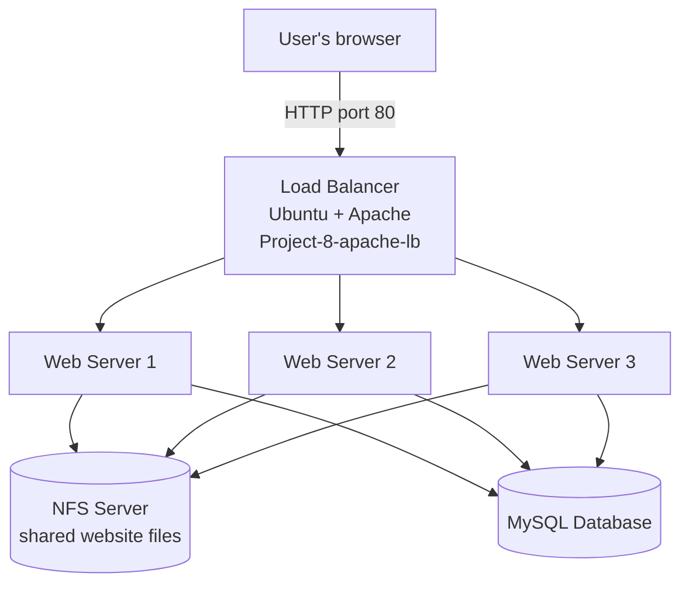
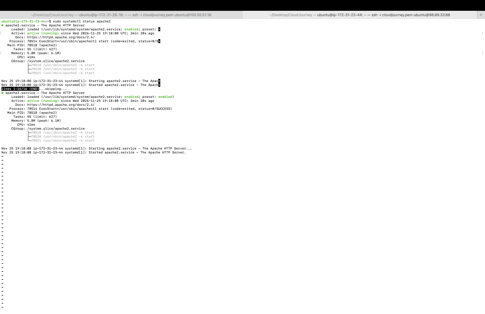
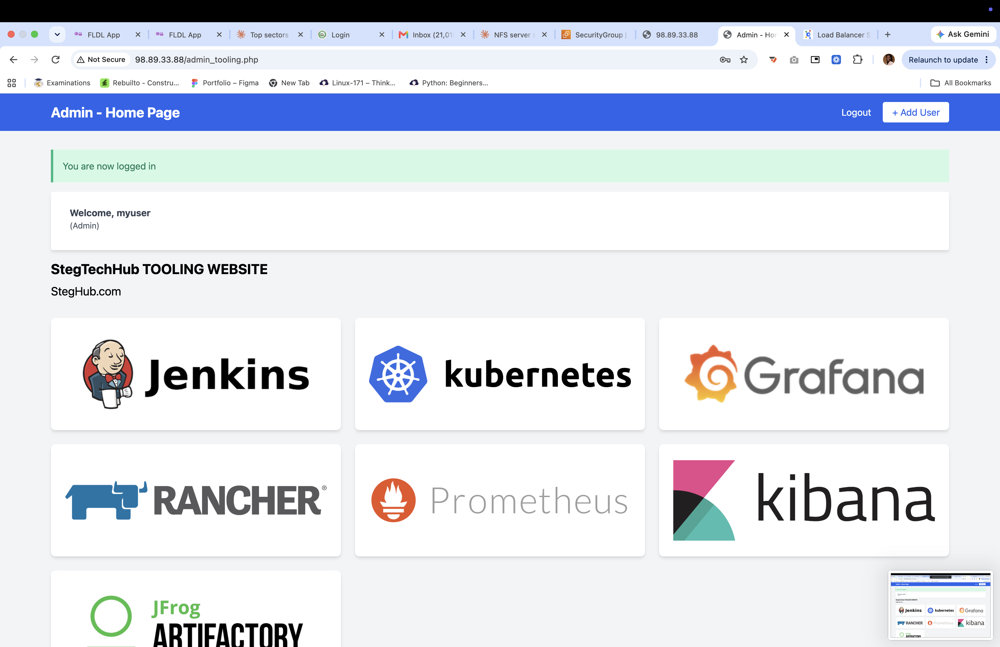
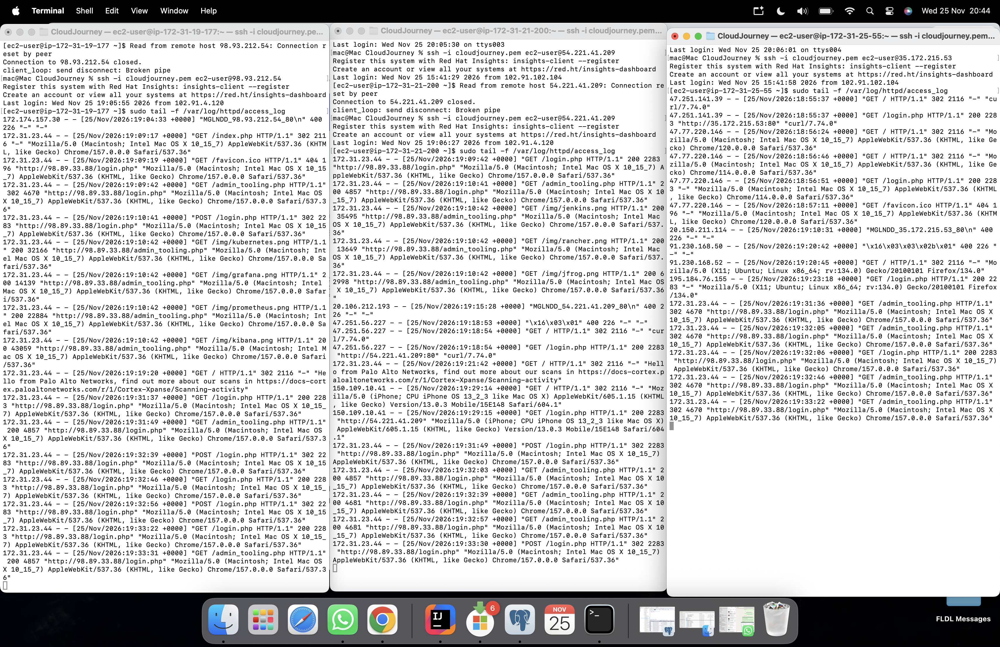
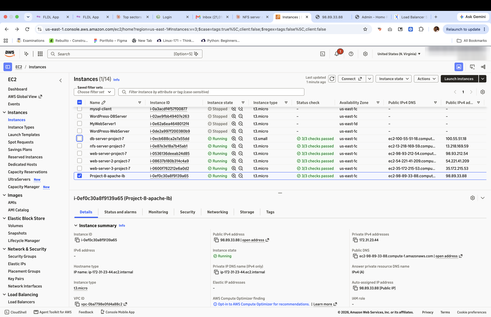

# Project 8: Load Balancer Solution with Apache

In this project I put an **Apache load balancer** in front of three web servers. Visitors use one address, and the load balancer shares their requests between the three servers.

This builds on [Project 7](../project-7), where I set up the web servers, the NFS server and the MySQL database.

## What is a load balancer?

Think of a busy restaurant with one person at the door and three waiters. The person at the door sends each new group of guests to a different waiter, so no waiter gets overwhelmed. If a waiter is unavailable, the door person can send guests to the others.

A load balancer is the person at the door:
- **Guests** are visitors' requests.
- **Waiters** are the web servers.
- **The door** is the load balancer's public IP address.

## Architecture



| Server | Role | 
|---|---|
| `Project-8-apache-lb` | Load balancer (Ubuntu + Apache) | 
| `web-server-project-7` | Web server 1 (RHEL 8) | 
| `web-server-2-project-7` | Web server 2 (RHEL 8) | 
| `web-server-3-project-7` | Web server 3 (RHEL 8) | 
| `nfs-server-project-7` | Shared storage for website files |
| `db-server-project-7` | MySQL database | 

## What is needed before starting

- The five servers from Project 7: three web servers, one NFS server and one MySQL server, all running
- An AWS account and my SSH key 
- The **private IP** of each web server (found in the EC2 console)

---

## Step 1: Create the load balancer server

1. In the AWS console, go to **EC2 → Launch instance**.
2. Fill in:
   - **Name:** `Project-8-apache-lb`
   - **AMI:** Ubuntu Server
   - **Instance type:** `t3.micro`
   - **Key pair:** my existing key pair
   - **Network settings:** same VPC and subnet as the other servers
3. In the **security group**, allow:
   - **SSH (22)** so I can connect
   - **HTTP (80)** from `0.0.0.0/0` so visitors can reach the load balancer
4. Click **Launch instance**.
5. Connect to it from my terminal:

```bash
ssh -i thekeypair.pem ubuntu@<load-balancer-public-ip>
```

## Step 2: Install Apache and turn on the proxy modules

Apache can act as a load balancer when its proxy modules are switched on.

```bash
sudo apt update
sudo apt install apache2 -y
sudo apt-get install libxml2-dev -y

sudo a2enmod rewrite
sudo a2enmod proxy
sudo a2enmod proxy_balancer
sudo a2enmod proxy_http
sudo a2enmod headers
sudo a2enmod lbmethod_bytraffic

sudo systemctl restart apache2
sudo systemctl status apache2
```

`active (running)` means Apache is working:



## Step 3: Tell Apache which servers to send traffic to

Open Apache's default site configuration:

```bash
sudo nano /etc/apache2/sites-available/000-default.conf
```

Add this **inside** the `<VirtualHost *:80> ... </VirtualHost>` section:

```apache
<Proxy "balancer://mycluster">
    BalancerMember <webserver1-private-ip-address>:80 loadfactor=5 timeout=1
    BalancerMember <webserver2-private-ip-address>:80 loadfactor=5 timeout=1
    BalancerMember <webserver3-private-ip-address>:80 loadfactor=5 timeout=1
    ProxySet lbmethod=bytraffic
    # ProxySet lbmethod=byrequests
</Proxy>

ProxyPreserveHost On
ProxyPass / balancer://mycluster/
ProxyPassReverse / balancer://mycluster/
```

Check the file and restart Apache:

```bash
sudo apache2ctl configtest
sudo systemctl restart apache2
```

`Syntax OK` means the file has no mistakes.

### What do these lines mean?

| Line | Plain-English meaning |
|---|---|
| `<Proxy "balancer://mycluster">` | Create a group of servers called `mycluster` |
| `BalancerMember http://<ip>:80` | Add this web server to the group (use its **private** IP) |
| `loadfactor=5` | How big a share of traffic this server gets. Equal numbers mean an equal share. |
| `timeout=1` | Give up on a server that doesn't answer within 1 second |
| `ProxySet lbmethod=bytraffic` | Share traffic based on how much data each server has handled |
| `ProxyPass / balancer://mycluster/` | Send every incoming request to the group |
| `ProxyPassReverse` | Make sure replies go back through the load balancer |
| `ProxyPreserveHost On` | Pass the original website address on to the web servers |

### Balancing methods

`bytraffic` is only one choice. You can swap it for another method:

| Method | How it shares traffic |
|---|---|
| `byrequests` | In turns, so each server gets the same number of requests |
| `bytraffic` | By the amount of data each server has handled |
| `bybusyness` | Sends to the server with the fewest active requests |
| `heartbeat` | Uses health messages from the servers |

## Step 4: Give each web server its own log folder

In Project 7 the web servers shared one log folder through NFS. To prove that each server receives traffic, each one needs its **own** log. Run this on **each of the three web servers**:

```bash
sudo systemctl stop httpd
sudo umount /var/log/httpd
sudo sed -i '\|/var/log/httpd|d' /etc/fstab
grep nfs /etc/fstab
sudo systemctl start httpd
```

The `grep` shows only the `/var/www` line, so the website files are still shared. Only the logs are separate now.

## Step 5: Test the load balancer

### Open the load balancer in a browser

```
http://<load-balancer-public-ip>/index.php
```

I got the tooling website's login page, then logged in with the admin user from Project 7. Everything works through the load balancer's address:



### Watch all three servers receive requests

On each web server I ran:

```bash
sudo tail -f /var/log/httpd/access_log
```

Refresh the page in my browser several times. New lines appeared in **all three** terminals:




This proves that:
- The load balancer receives my request.
- It forwards the request to the web servers.
- All three servers share the work.

### All servers running



## What I learned

- What a **load balancer** is and why websites use one
- How to turn Apache into a load balancer with the **proxy modules**
- How `BalancerMember`, `loadfactor` and `lbmethod` control where traffic goes
- Why web servers use **private IPs** inside the network, while visitors use one **public IP**
- How to read an Apache **access log** to confirm traffic is being shared

## Useful commands

```bash
sudo systemctl status apache2        # is the load balancer running?
sudo apache2ctl configtest           # check the config for mistakes
sudo systemctl restart apache2       # apply config changes
apache2ctl -M | grep -E "proxy|balancer|lbmethod|headers"    # list enabled modules
sudo tail -f /var/log/httpd/access_log    # watch requests live (on a web server)
```


## Tech stack

AWS EC2 · Ubuntu · Apache 2 (mod_proxy, mod_proxy_balancer) · RHEL 8 · NFS · MySQL
